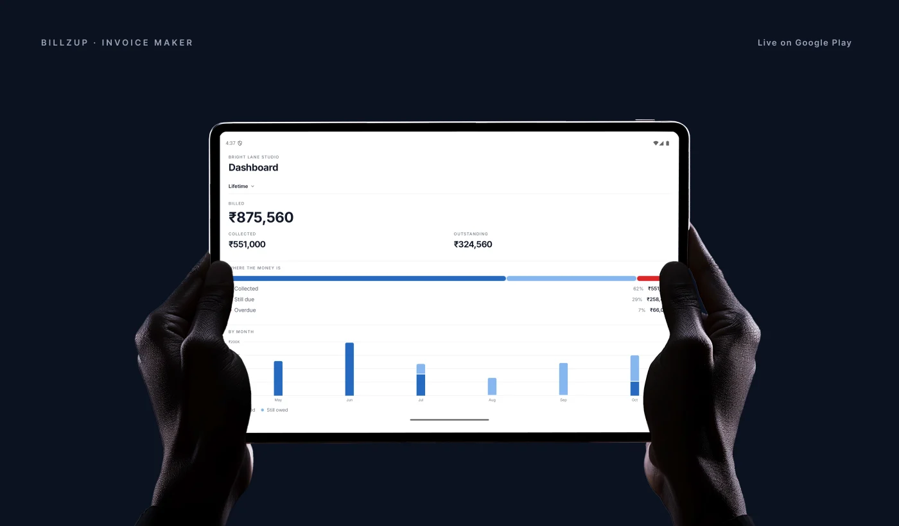
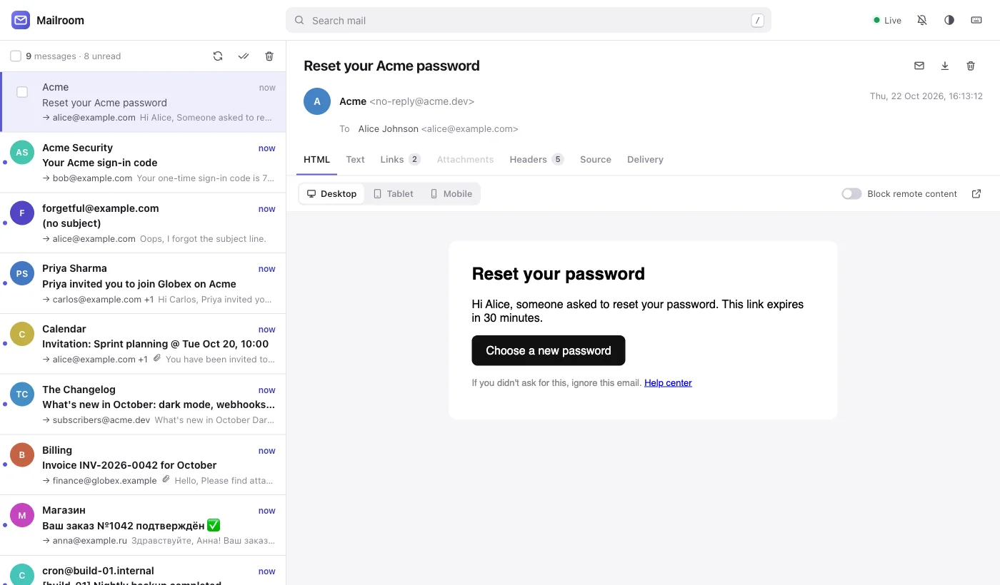
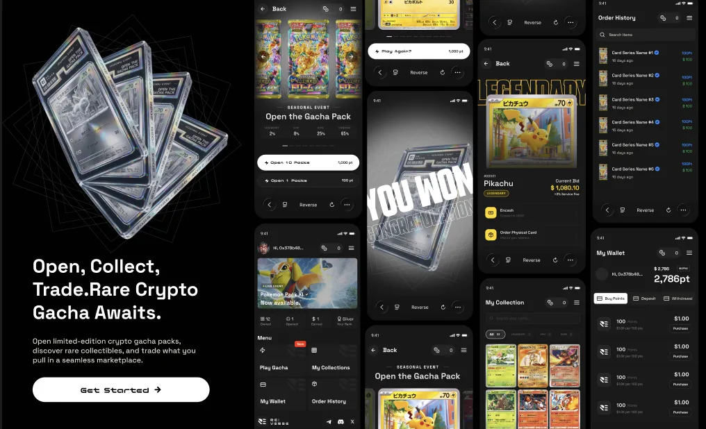
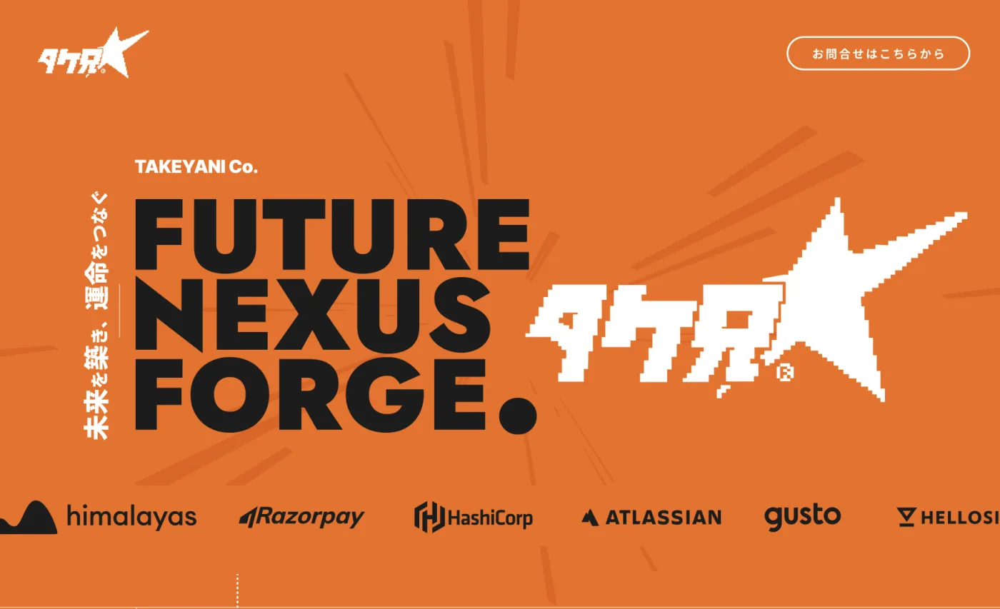

# Hi, I'm Deepak Yadav 👋

### Full Stack Developer — web, mobile & developer tools

I build products end to end: pixel-perfect frontends, the APIs behind them, and the infrastructure they run on.

 

## 🚀 Featured Work

<table>
  <tr>
    <td width="50%" valign="top">
      
      <h3>Billzup</h3>
      <b>MOBILE APP · FULL STACK</b>
      
Offline-first invoice &amp; estimate maker for Android, live on the Play Store. No account, no subscription, 56 invoice designs.

      <a href="https://play.google.com/store/apps/details?id=com.nexttinstudio.billzup">Google Play →</a>
    </td>
    <td width="50%" valign="top">
      
      <h3>Mailroom</h3>
      <b>DEVELOPER TOOL · RUST</b>
      
Single-binary SMTP server and web inbox for testing email locally, with a wait API and link/OTP extraction for automated tests.

      <a href="https://github.com/dny5112001/mailroom">View repo →</a>
    </td>
  </tr>
  <tr>
    <td width="50%" valign="top">
      
      <h3>REVERSE.</h3>
      <b>WEB APP · FULL STACK</b>
      
Crypto gacha platform: open limited-edition packs, collect rare digital items and trade pulls in a marketplace.

      <a href="https://www.reversetcg.xyz/">Visit site →</a>
    </td>
    <td width="50%" valign="top">
      
      <h3>TAKEYANI Co.</h3>
      <b>WEBSITE · FRONTEND</b>
      
Corporate site for a tech &amp; creative agency covering system development, marketing, video and international trade.

      <a href="https://takeyani.com/">Visit site →</a>
    </td>
  </tr>
  <tr>
    <td width="50%" valign="top">
      
      <h3>Tomomi Nagamori Clinic</h3>
      <b>WEBSITE · FRONTEND</b>
      
Portfolio site for a premium art-makeup artist, with treatment galleries and booking.

      <a href="https://www.nagamoriart-make.com/">Visit site →</a>
    </td>
    <td width="50%" valign="top">
      <h3>🧪 Side projects</h3>
      
<a href="https://github.com/dny5112001/marginalia"><b>marginalia</b></a> Local-first Markdown knowledge base · Tauri 2 + React

      
<a href="https://github.com/dny5112001/notchy"><b>notchy</b></a> Your Mac, with a personality — talks to you from the notch

      <h3>📚 Guides in plain English</h3>
      

        <a href="https://github.com/dny5112001/rust-zero-to-hero">Rust</a> ·
        <a href="https://github.com/dny5112001/system-design-zero-to-hero">System Design</a> ·
        <a href="https://github.com/dny5112001/kubernetes-zero-to-hero">Kubernetes</a> ·
        <a href="https://github.com/dny5112001/terraform-zero-to-hero">Terraform</a> ·
        <a href="https://github.com/dny5112001/k8s-terraform-lab">K8s + Terraform lab</a>
      

    </td>
  </tr>
</table>

 

## 🛠️ Tech Stack

  

  

 

## 📊 GitHub Stats

 

**Open to freelance work and full-time roles — let's build something great together.**

